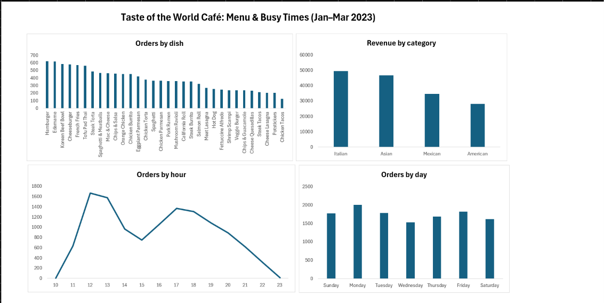

# Taste of the World Café: Menu & Busy Times (Excel)

An Excel analysis of 12,234 restaurant order items (Jan–Mar 2023) to help the owner decide **which dishes work, which don't, and when to staff up**.

## The brief
"We launched a new menu at the start of the year. What's working and what isn't? Should I drop anything? And when are we busiest? I'm thinking about staffing."

## Questions answered
1. Which dishes are ordered most and least?
2. Which food categories bring in the most money?
3. Which days and hours are busiest?

## Key findings
- **Most ordered: Hamburger (622). Most money: Korean Beef Bowl ($10,555).** Popular and profitable are not always the same dish.
- **Weakest dish: Chicken Tacos** (123 orders, $1,470). It is the main candidate to review or drop.
- **Edamame is the 2nd most ordered dish (620)** but brings in only $3,100 because it costs $5. Keep it: many customers want it.
- **Italian brings in the most money ($49,463, 31%)** because its dishes cost the most (avg $16.75). Asian sells the most items (3,470) but at lower prices.
- **Two rush periods: lunch 12–2pm and dinner 5–7pm.** The hour matters much more than the day (about 3× difference vs 1.3×).
- **Monday is the busiest day (2,010 items); Wednesday the quietest (1,531).**

## Recommendations
1. Review Chicken Tacos: improve, reprice or remove it.
2. Keep Edamame: it is cheap but very popular.
3. Promote high-value Italian and Asian dishes.
4. Staff up for lunch (12–2pm) and dinner (5–7pm), with extra cover on Mondays.

## How I did it (Excel)
- **XLOOKUP** to bring dish name, category and price from the menu table into the orders table (with `$` locked ranges)
- **COUNTA / COUNTIF** to check data quality
- **HOUR** and **TEXT** to create hour and day columns
- **Pivot tables + PivotCharts** for the analysis and dashboard

## Data cleaning
- **136 of 12,234 rows (1.1%) had no item recorded (NULL).** Kept them: excluded from dish/category analysis, included in busy-time analysis (the orders still happened).
- **Dates were in US format (month/day).** Excel read them as day/month, giving wrong or text dates. Fixed by re-importing with Power Query using the English (United States) locale. Before the fix, the busiest day looked like Sunday; after the fix, it is Monday.

## Data
[Restaurant Orders](https://mavenanalytics.io/data-playground) by Maven Analytics (free). Original CSV files are not uploaded.

## Files
- `restaurant_analysis.xlsx`: the workbook (data, pivots, dashboard)
- `images/dashboard.png`: dashboard screenshot
